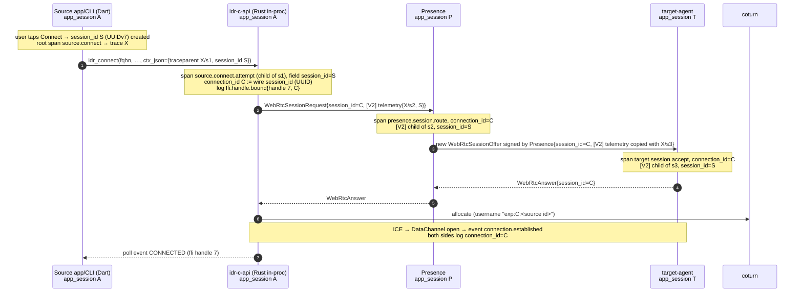

# 01: Architecture

## 1. Principles

1. **Logs are for root-cause analysis.** Every record must answer at least one of these: what happened, where, when, to which operation, or why. A record that answers none of them is noise and is not written.
2. **One schema, many languages.** Dart, Rust, Node and Python emit the same JSON record (`idr.log/1`, see [03](03-log-schema-and-events.md)). Language libraries are thin implementations of one spec, verified by shared conformance tests.
3. **Standards over invention.**
   - Trace and span IDs follow W3C Trace Context (OpenTelemetry-compatible), with no prefixes.
   - Other IDs are UUIDs (RFC 9562).
   - Attribute names follow OpenTelemetry semantic conventions where one exists (`error.type`, `server.address`, `network.transport`, `http.response.status_code`).
4. **Context travels with the work, not through globals.**
   - Within a process: Dart `Zone` values and Rust `tracing` span scope.
   - Across processes: W3C `traceparent`.
   - Code never passes IDs by hand into each log call.
5. **Spans are log records.**
   - A span emits one `kind:"span"` record when it ends: name, IDs, parent, start, duration, status.
   - A trace tree can be rebuilt from a log file alone, offline, from a user's bundle.
   - An OTLP export can be added later without changing instrumentation ([09 D3](09-decisions-risks-approval.md)).
   - **Long-lived operations also write a start record.** These are spans registered `persist_start: true`: session, connection, transfer, agent startup, and IPC commands longer than 1 s. They also emit their registered `*.started` event when they begin. Work that is in flight when a native crash happens is therefore visible on disk, as best effort ([04 §3](04-storage-crash-diagnostics-privacy.md)).
6. **Each process owns its own sink.** No process parses another process's stdout to obtain logs. Files from one machine share a directory and are merged by timestamp and IDs.
7. **Quiet by default, detailed when it matters.**
   - INFO is written to disk.
   - DEBUG goes into an in-memory flight recorder that is flushed only on ERROR, crash, stall, or user report ([04 §2](04-storage-crash-diagnostics-privacy.md)).
8. **Privacy by construction.**
   - Secrets are typed (`Secret<T>`, `Sensitive`) and cannot be formatted.
   - Personal data is never logged in clear.
   - Export and upload require explicit user approval and re-run redaction.
9. **Logging never breaks the product.**
   - Sinks are asynchronous and bounded.
   - On overload, records are dropped and counted.
   - Logging failures never throw into callers.
10. **Terminal UI output is not logging.**
    - The CLI `Ui` class (results, prompts, `--json` envelopes) stays a separate concern.
    - It may *also* log, but logs never replace it, and it never writes the log file.

## 2. Package and repository structure

### 2.1 Where the shared code lives

**Decided (D1, 2026-11-23): the agent monorepo.** The shared code lives inside `agents_engine/agent`, which [ADR-0001](../adr/0001-monorepo.md) already makes the monorepo for shared Rust crates and Dart packages. It sits next to `idr-protocol`, `idr_client` and `idr_dp_ffi`, which every other consumer already depends on. The decision is recorded in [ADR-0019](../adr/0019-observability.md).

```text
agents_engine/agent/
├── spec/telemetry/
│   ├── log-record.schema.json        JSON Schema for idr.log/1 records
│   ├── events.yaml                   Event + span registry (names, level, required attrs, owner)
│   ├── attributes.yaml               Attribute registry (name, type, privacy class)
│   └── vectors/                      Conformance test vectors (IDs, traceparent, ctx, redaction, records)
├── crates/idr-telemetry/             Rust crate (workspace member)
├── packages/
│   ├── idr_telemetry/                Pure Dart package (no Flutter; melos member)
│   ├── idr_telemetry_flutter/        Flutter hooks only
│   └── idr_diag/                     Dart CLI: validate/lint/merge/tree/open bundles
└── docs/observability/               These documents
```

**Consumption:**

| Consumer | How it depends on the shared code |
|---|---|
| Agent crates and services | `idr-telemetry = { workspace = true }` |
| Agent Dart packages (`idr_client`, …) | `path: ../idr_telemetry` |
| `applications/apps` | `path:` dependency into `agents_engine/agent/packages/…`, like `idr_client` and `idr_dp_ffi` today. Release builds use `git:` + `ref:`. |
| Presence and Relay (separate repos) | A `git` dependency on the agent repo, pinned by tag (`idr-telemetry = { git = "…/agent", tag = "telemetry-v1.0.0" }`). This is a step towards the ADR-0001 open item of depending on agent crates instead of copying them. |

### 2.2 Dependency graph

```text
                  spec/ (schema, events.yaml, attributes.yaml, vectors)
                     │ validated by tests in both libs
        ┌────────────┴────────────────┐
        ▼                             ▼
  idr-telemetry (Rust)          idr_telemetry (Dart, pure)
   deps: tracing,                deps: none beyond SDK
   tracing-subscriber,           (dart:io, dart:isolate,
   uuid(v7), serde_json,          dart:convert, dart:math)
   time                                │
        │                              ├──► idr_telemetry_flutter
        │                              │      deps: flutter, path_provider
        │                              │
  ┌─────┼────────────┬─────────┐       ├──► idr_client (agent repo)
  ▼     ▼            ▼         ▼       ├──► idr_session, idr_source, idr_target (sdks)
idr-c-api target-   source-  Presence  ├──► idr_cli_core ──► idrs, idr
idr-dp-ffi agent    agent    Relay     └──► idr_target_app (via idr_telemetry_flutter)
idr-wasm (feature)
  (libs below these use only the `tracing` facade, never idr-telemetry)

dp-sdk crates: NO dependency on either. Never log. Return typed errors.
```

**Rules embedded in the graph:**
- **Library crates** (`idr-core`, `idr-source`, `idr-target`, `idr-transfer`, `idr-signaling`, `idr-webrtc`, `idr-protocol`):
  - They depend only on the `tracing` facade, plus `idr-telemetry` **types** behind the `idr-telemetry/types` feature: field-name constants, `Secret<T>`, `TraceContext`.
  - They never install subscribers.
- **Composition points** call `idr_telemetry::init` exactly once per process. These are the binaries plus the FFI or wasm entry.
- **Dart SDK packages** depend on `idr_telemetry` (pure). Only the Flutter app depends on `idr_telemetry_flutter`. This follows `my_programming_rule/flutter-package-first.md`.

### 2.3 Rust crate `idr-telemetry`: responsibilities and interface

```rust
// ---- init (composition points only) ----
pub struct Config {
    pub service: &'static str,          // "target-agent", "presence", "idr-c-api"...
    pub service_version: &'static str,
    pub log_dir: Option<PathBuf>,       // None = stdout only (servers)
    pub stdout: StdoutFormat,           // Json | Pretty | Off
    pub filter: String,                 // default from IDR_LOG, else "info"
    pub app_session_id: Option<Uuid>,   // Some = embedded (adopt host's), None = mint
    pub parent_app_session_id: Option<Uuid>, // spawned agents: from IDR_PARENT_APP_SESSION_ID
    pub recorder_bytes: usize,          // DEBUG ring byte cap, default 3 MiB, 0 = off
    pub queue_bytes: usize,             // writer queue byte cap, default 1 MiB
}
pub fn init(cfg: Config) -> Result<TelemetryGuard, InitError>; // guard flushes on drop
pub fn init_from_env(service, version) -> ...;                 // reads IDR_LOG*, TRACEPARENT

// ---- identity ----
pub fn app_session_id() -> Uuid;
pub fn new_id() -> Uuid;                       // UUIDv7

// ---- trace context ----
pub struct TraceContext { pub trace_id: [u8;16], pub span_id: [u8;8], pub sampled: bool }
impl TraceContext { fn parse(traceparent: &str) -> Option<Self>; fn to_traceparent(&self) -> String; }
pub fn current() -> Option<TraceContext>;      // from the current tracing span
pub trait SpanExt { fn set_remote_parent(&self, ctx: TraceContext); fn link(&self, ctx: TraceContext); }

// ---- privacy ----
pub struct Secret<T>(T);    // see contract below
impl<T> Secret<T> { pub fn expose(&self) -> &T; }   // the only way to read the value
pub fn redact(s: &str) -> Cow<str>;            // same rules + vectors as Dart
pub fn hash_pii(s: &str) -> String;            // keyed hash, see 04 §5.3

// ---- crash / FFI ----
pub fn install_panic_hook();                   // sync write of crash record + flight recorder
pub fn ffi_guard<R>(name: &'static str, default: R, f: impl FnOnce() -> R + UnwindSafe) -> R;
                                               // catch_unwind → crash record → error code

// ---- field names (single source; generated from attributes.yaml) ----
pub mod fields { pub const SESSION_ID: &str = "session_id"; pub const CONNECTION_ID: &str = "connection_id"; ... }
```

**`Secret<T>` contract.** The wire and the logs are handled separately:

| Concern | Behaviour |
|---|---|
| Wire / storage | `Serialize`/`Deserialize` are **transparent** (`#[serde(transparent)]`), so a protocol credential such as `connection_token` still travels and its bytes and signatures are unchanged. |
| Formatting | `Debug` and `Display` print `[REDACTED]`. |
| Telemetry | It does not implement `tracing::Value`, so it cannot be recorded as a span or event field. The Dart `Secret` throws if it is passed into `attrs`. |
| Access | Only `expose()` / `.value`. Code review can grep for this. |

**Internals:**
- **Span IDs layer.** A `tracing_subscriber::Layer` assigns a W3C `span_id` to every span and a `trace_id` to root spans (or adopts a remote parent). The IDs live in span extensions.
- **JSON formatter.** It writes `idr.log/1` records and flattens the correlation fields of the current span scope (`session_id`, `connection_id`, `transfer_id`, `operation_id`) into each event.
- **Filtering.**
  - When the recorder is on, the global filter is DEBUG: DEBUG call sites stay active and feed the ring.
  - The file and stdout layers filter to their own level (INFO by default).
  - TRACE is never captured unless explicitly enabled.
- **Privacy stage.**
  - Every string value in a record is redacted **before** the record is handed to any writer. This covers `msg`, `error.*` including stack and causes, and string attributes such as `stderr_tail` and `panic.message`.
  - The ring, the file and crash records therefore never hold unredacted text ([04 §5](04-storage-crash-diagnostics-privacy.md)).
- **Writers.** All are byte-capped, each with its own drop policy ([04 §6](04-storage-crash-diagnostics-privacy.md)):
  - **writer queue (1 MiB):** a bounded async channel to the size-rotating file writer. It **drops the incoming record** when full. The writer holds the run's lock for the process lifetime ([04 §1.3](04-storage-crash-diagnostics-privacy.md)).
  - **stdout:** shares the same queue policy.
  - **flight-recorder ring (3 MiB):** **evicts the oldest record** when full. It is drained by the writer itself (snapshot split at the watermark and direct write), never through the queue ([04 §2.1](04-storage-crash-diagnostics-privacy.md)).
- **Not used:** the OpenTelemetry SDK ([D3](09-decisions-risks-approval.md)).

**Feature flags:**
- `types` (default): constants, `Secret`, `TraceContext`. No subscriber dependencies.
- `subscriber`: init, the layers and the writers.
- `wasm`: browser console sink plus an in-memory ring, with no files.

### 2.4 Dart package `idr_telemetry` (pure Dart)

```dart
// ---- init (composition points only: app main, CLI main) ----
Future<void> Telemetry.init(TelemetryConfig config);
class TelemetryConfig {
  final String service;            // 'idr_target_app', 'idrs', 'idr'
  final String serviceVersion;
  final String? logDir;            // null = no file (tests)
  final Level fileLevel;           // default info
  final Level stderrLevel;         // CLI: off, or debug with -v
  final int recorderBytes;         // default 3 MiB (mobile 1 MiB), 0 = off
  final int queueBytes;            // default 1 MiB
}
String get appSessionId;
Future<void> Telemetry.flush();
String newId();                    // UUIDv7

// ---- logging ----
final log = IdrLog('idr_source.connect');   // component (dotted, lowercase)
log.info('connection.attempt.started', {'transport.preference': 'p2p'});
log.warn('presence.reconnect.scheduled', {'retry.attempt': 3, 'retry.delay_ms': 4000});
log.error('connection.attempt.failed', error: e, stack: st, attrs: {...});

// ---- spans and correlation scope (Zone-based) ----
Future<T> span<T>(String name, Future<T> Function(Span s) body,
    {Map<String, Object?> attrs, TraceContext? remoteParent, bool newTrace = false,
     List<TraceContext> links = const []});
T withIds<T>(T Function() body, {String? sessionId, String? connectionId,
    String? transferId, String? operationId});
TraceContext? currentTrace();      // for propagation (HTTP header, FFI arg, env)
String? currentTraceparent();
String currentContextJson();       // {traceparent, session_id, operation_id, transfer_id} for FFI/IPC/isolates

// ---- privacy ----
String redact(String s);           // moved from idr_cli_core, extended
class Secret<T> { ... toString() => '[REDACTED]' }
String hashPii(String value);

// ---- crash (pure Dart) ----
R runGuarded<R>(R Function() body); // runZonedGuarded + Isolate error listener → crash record

// ---- diagnostics ----
Future<DiagnosticBundle> DiagnosticBundle.collect({Duration window, String? userNote, List<String> extraDirs});
```

**Internals:**
- **Zone values** carry the current span and the correlation IDs. `span()` forks a Zone.
- **Isolates:** a new isolate does not inherit the Zone. The caller passes `currentContextJson()`, and the isolate entry restores it with `span(remoteParent:)` + `withIds`. This applies to the FFI isolate in `idr_client` and the IPC isolate in `agent_ipc.dart`.
- **Privacy stage:** the same as in Rust. All strings are redacted before any sink, the ring included.
- **Sinks:** a file sink using `IOSink` with size rotation and the run lock held for the process lifetime, a stderr sink (CLI `-v`), and a byte-capped ring buffer drained by the sink itself ([04 §2.1](04-storage-crash-diagnostics-privacy.md)). Writes are batched on a microtask timer (50 ms) and never awaited by callers.

### 2.5 `idr_telemetry_flutter`

The package contains only:
- `TelemetryFlutter.install()`, which wires up:
  - `FlutterError.onError`
  - `PlatformDispatcher.instance.onError`
  - `Isolate.current.addErrorListener`
  - `AppLifecycleListener` (records `app.lifecycle.changed`)
  - the log directory from `path_provider` (`getApplicationSupportDirectory()/logs`)
- `NavigatorObserver` → `ui.screen.viewed` (a route name, never route arguments).
- **No UI widgets.** The "Report a problem" screen belongs to the app and uses `DiagnosticBundle`, per the package-first rule.

### 2.6 Non-Rust, non-Dart servers

These are too small to justify a shared library:

| Component | Implementation |
|---|---|
| usage-reporter (Node, zero dependencies) | One ~30-line `log(level, event, attrs)` function in the file, producing `idr.log/1`. Sends `traceparent` and `x-request-id` to Billing. |
| DNS updater (Python) | A ~20-line `logging.Formatter` subclass producing `idr.log/1`. |
| coturn | Left as coturn text. The collector parses it and tags `service=turn` ([04 §7](04-storage-crash-diagnostics-privacy.md)). |
| PowerDNS / dnsdist | Unchanged. Query logging stays off. |

All three are checked by the same schema-validation test (Phase 2, V1).

## 3. Per-process integration

| Process | Init point | `app_session_id` | File sink | Stdout | Notes |
|---|---|---|---|---|---|
| Flutter Target app | `main()` → `Telemetry.init` + `TelemetryFlutter.install` + `runGuarded` | mint | `<logdir>/idr_target_app/` | off | Passes its ID and `traceparent` to spawned target-agent |
| `idrs` / `idr` CLI | `bin/*.dart` before `CliRunner` | mint per invocation | `<logdir>/idrs/`, `<logdir>/idr/` | stderr only with `-v` (pretty) | `Ui` stays for user output |
| In-process Rust (`idr-c-api` in a Dart host) | new `idr_telemetry_init(config_json)` called by `idr_client` | **adopt the host's** | `<logdir>/<host>/<…>.rust.jsonl` | off | Separate file and its own `seq`, same `app_session_id`. Panics captured by `ffi_guard` |
| `idr-dp-ffi` | shares the host's init when linked into `idr-c-api`; standalone it logs nothing (crypto) | — | — | — | Only `ffi_guard` (no panic crosses the ABI) |
| `target-agent` (spawned) | `main.rs` → `init_from_env` | mint; `parent_app_session_id` from env | `<logdir>/target-agent/` | `Pretty` if TTY, else `Off` when spawned by the app | Dart stops reading stdout as logs |
| `source-agent` (daemon) | same | mint; parent from env | `<logdir>/source-agent/` | same | Replaces `IDR_LOG_FILE` truncation |
| `idr-wasm` (browser) | `init` with feature `wasm` | mint | none (ring + console) | console | Bundle export via a JS API |
| Presence, Relay | `main.rs` → `init_from_env` | mint (= OTel `service.instance.id`) | none | `Json` | Collector ships stdout |
| usage-reporter, DNS updater | built-in function / formatter | mint at start | none | JSON | |

**Unified environment variables** (these replace `RUST_LOG`, `IDR_LOG`, `IDR_LOG_LEVEL`, `IDR_LOG_JSON` and `IDR_LOG_FILE`):

| Var | Meaning | Default |
|---|---|---|
| `IDR_LOG` | Filter directive (`info,idr_target::webrtc=debug`) | `info` |
| `IDR_LOG_FORMAT` | Stdout format: `json` / `pretty` / `off` | servers `json`, TTY `pretty`, else `off` |
| `IDR_LOG_DIR` | Directory for the file sink (unset = no file) | set by the parent app |
| `IDR_PARENT_APP_SESSION_ID` | The parent process's `app_session_id` | — |
| `TRACEPARENT` | W3C context for the process's first operation | — |

`RUST_LOG` is honoured, with a deprecation warning event, for one minor release, then removed ([D8](09-decisions-risks-approval.md)).

## 4. Cross-component context propagation

**Release scope** ([09 §0](09-decisions-risks-approval.md)):
- **V1** propagates context **within one machine**: Dart, the isolates, Rust FFI, the spawned agents, IPC, and HTTP headers to Billing.
- **V2** adds context **on the signaling wire** (Source, Presence, Target, Relay).
- In V1, records on different machines are joined by the shared wire IDs (`connection_id`, `transfer_id`), `target.fqhn`, and time.

### 4.1 Carriers

| Hop | Carrier | Carries | Release |
|---|---|---|---|
| Dart → Dart (same isolate) | Zone | span + IDs | V1 |
| Dart → isolate | message field `ctx` = `currentContextJson()` | `traceparent` + `session_id`, `operation_id`, `transfer_id` | V1 |
| Dart → Rust FFI (`idr_client` → `idr-c-api`) | a new trailing nullable `const char* ctx_json` argument on the existing `idr_connect`, `idr_open_stream`, `idr_transfer_send`, `idr_transfer_send_selection`, `idr_transfer_resume` (ABI version bump; app and library ship together). Rust parses it, parents its span from `traceparent`, and records the other IDs as span fields. | the full context (§4.2) | V1 |
| Rust FFI → Dart (handle → `connection_id`) | **No return channel.** Rust logs `ffi.handle.bound{ffi.handle, connection_id}` in its own file under the same `app_session_id` and parent span, and `idr_diag` joins on that. Dart logs only the handle. | — | V1 |
| Dart → spawned agent | env `TRACEPARENT`, `IDR_PARENT_APP_SESSION_ID`, `IDR_LOG_DIR` | start-up trace | V1 |
| Dart → agent IPC (`agent_ipc.dart`) | request field `"ctx"` (NDJSON tolerates unknown fields) | full context | V1 |
| Dart → Billing HTTP | `traceparent` header; the response `x-request-id` is logged as `http.request_id` | trace | V1 (send and capture); Billing reading it is V2 (optional) |
| Source → Presence | `telemetry` on `WebRtcSessionRequest` | `traceparent`, `logical_session_id` | **V2** |
| Presence → Target | `telemetry` on **`WebRtcSessionOffer`**. Presence **builds and signs a new offer** (`Servers/presence/src/source/mod.rs:361`), so it copies `telemetry` from the request into the offer, with `traceparent` set to its own routing span. | same | **V2** |
| Target → Presence | `telemetry` on `TargetRegistration` | registration trace | **V2** |
| Relay → Presence → Target (wake) | `telemetry` on `EnsureRelayConnectionCommand` (and on the command Presence forwards) | Relay's trace | **V2** |
| Relay ↔ Target (postcard `ClientHello`) | **No new field.** Correlates by `connection_id` (wire `session_id`), which is already present. | — | — |
| Source ↔ Target data channel (`StreamFrame`, transfer header) | **No new field.** Correlates by `transfer_id` and `connection_id`. | — | — |
| Presence → TURN | the TURN username already embeds the wire `session_id`, i.e. `connection_id` | — | V1 (existing) |
| Presence / Relay / reporter → Billing | `traceparent` + `x-request-id` | trace | V1 (send) |

### 4.2 Context payloads

**Local context (`ctx_json`), V1.** It is used for FFI, isolates and IPC:

```json
{"traceparent":"00-4bf92f3577b34da6a3ce929d0e0e4736-00f067aa0ba902b7-01",
 "session_id":"019372b4-6b1e-7cc2-9a59-0b5c9f0e2a11",
 "operation_id":null, "transfer_id":null}
```

- W3C `traceparent` carries only version, trace ID, parent span ID and flags. The other IDs therefore travel beside it, never inside it.
- The receiver validates each field. A field that is invalid or missing is ignored and logged as `telemetry.context.invalid` at DEBUG.

**Wire `telemetry` object, V2.** It is carried on `WebRtcSessionRequest`, `WebRtcSessionOffer`, `TargetRegistration` and `EnsureRelayConnectionCommand`:

```json
"telemetry": { "traceparent": "00-…-…-01", "logical_session_id": "019372b4-…" }
```

- **Rust type:** `Option<TelemetryContext>` with `#[serde(default, skip_serializing_if = "Option::is_none")]`.
- **Excluded from signature canonicalization.** Every signer and verifier clears `telemetry` before canonical JSON, the same way `signature` is cleared. This applies to the Source (request), Presence (offer, which Presence signs), the Target (registration), the Relay (command), and **all verifiers** (Presence, Target, Relay), in all three protocol copies.
- **Rollout order** ([09 R2](09-decisions-risks-approval.md)):
  1. Every verifier learns to clear the field.
  2. Then signers start sending it, behind `IDR_WIRE_TELEMETRY=1`.
- **Tests:**
  - golden vectors for all four messages with and without the field
  - an old-verifier × new-signer test in both directions
  - a Presence offer-copy test (request `telemetry` → offer `telemetry`)
- **Untrusted:** receivers use it only to parent or link spans. It is never used for authorization and never echoed to other tenants.
- **Missing or invalid:** the receiver starts a new root trace and logs `telemetry.context.missing` at DEBUG.

### 4.3 Parent/child and links

- A **child span** is used when the remote work is caused by, and synchronous with, the parent. Examples (V2): the Target handling the offer is a child of Presence's routing span, which is a child of the Source's `signaling.session_request` span.
- A **span link** (no parent) is used when work is related but its lifetime is independent. Examples:
  - each reconnect attempt is a new trace, linked to the previous attempt's trace
  - a resumed transfer's new trace links to the trace of the original send
  - a background registration refresh links to the registration trace
  - a Relay wake on the Target links to the Relay's trace (V2)
- **Long waits never stay open as spans.** An enrollment awaiting admin approval for hours is an `operation_id`, with short traces for each poll or step.

## 5. Cross-component flow (Source connects to Target over WebRTC)

**V1** correlates across machines through `connection_id` C. **V2** adds the shared trace X across machines.



**V1 investigation:** from the user's local bundle, take `C` from `ffi.handle.bound` / `connection.*`, then search the Presence and Target logs for `connection_id=C`.

**V2 investigation:** additionally, `trace_id=X` returns the whole tree across machines in one query.

## 6. Data flow: from event to developer

```text
 Device (V1)                                               Servers
 ┌───────────────────────────────────────────┐            ┌─────────────────────────────┐
 │ Dart (GUI/CLI) ─┐                          │            │ Presence  ─┐ stdout JSON (V1)│
 │ Rust in-proc  ──┼─► <logdir>/<svc>/*.jsonl │            │ Relay     ─┤                 │
 │ target-agent  ──┤   (rotating, 7 days)     │            │ reporter  ─┤                 │
 │ source-agent  ──┘                          │            │ coturn    ─┘ text            │
 │   + flight recorder (RAM) → flush on error │            │      │ journald/podman        │
 │   + crash/ records                         │            │ ------------- V2 ----------- │
 │         │ user: "Report a problem"         │            │  Grafana Alloy (per host)    │
 │         ▼ V1: export zip, user attaches it │            │      │ parse, redact         │
 │  DiagnosticBundle.zip (report_id)          │  V2 HTTPS  │  diag-ingest ──► object store │
 │         └──────────────────────────────────┼──────────► │      ▼                       │
 └───────────────────────────────────────────┘            │  Loki (14 d) ◄── Grafana UI  │
                                                          └─────────────────────────────┘
 V1: developer opens the bundle with idr_diag, then greps server JSON by connection_id / transfer_id / time.
 V2: report display code → manifest IDs → one Grafana query.
```
