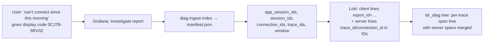

# 05: Investigation Scenarios

Each scenario shows four things:

- the records the new system produces
- how a developer gets from the report to the cause
- which design element makes that possible
- what the developer would see today

Records are abbreviated. `A`, `S`, `C`, `T` and `X` stand for `app_session_id`, `session_id`, `connection_id`, `trace_id` and `transfer_id`.

**V1 vs V2.**
- In **V1**, client records come from the bundle the user attached. Server records are found by the shared wire IDs (`connection_id`, `transfer_id`), `target.fqhn`, and time, because the trace ID does not cross machines yet.
- Lines marked **[V2]** need wire trace propagation or central collection.

## 0. The common entry point: from a user report to the IDs

**V1:**
1. The user attaches `<report_id>.zip`.
2. `idr_diag open` lists the app runs, sessions, connections, transfers and traces, with failures highlighted.
3. The developer takes the `connection_id` / `transfer_id` values and the time window, and searches the server JSON logs (`journalctl … | jq`).

**V2:**



**Without a bundle** (an automatic alert, or a user who will not upload):

1. Start from a pseudonymous key the server already has: `target.fqhn`, `device.ski`, or the time window.
2. Find the `trace_id` / `connection_id` values in the Presence and Relay records.
3. If needed, ask the user for a bundle that covers those times.

## 1. Failed Source–Target connection (ICE failure, TURN unreachable)

**Report.** "`idrs connect gpu--acme.idr.to` hangs, then says connection failed."

**Source records (`idrs` + in-process Rust):**

```text
INFO  session.started            S  target.fqhn=gpu--acme.idr.to
INFO  connection.attempt.started S C1 T1  transport=p2p retry.attempt=0
(DEBUG, flushed) signaling.message.sent      T1 message.type=webrtc_session_request
(DEBUG, flushed) signaling.message.received  T1 message.type=webrtc_session_offer
(DEBUG, flushed) webrtc.ice.candidate_gathered  candidate.type=host  (x3)  srflx (x0!)  relay (x0!)
INFO  webrtc.ice.state_changed   C1 from=checking to=failed
WARN  connection.attempt.failed  C1 T1 error.type=ice_failed phase=ice elapsed_ms=30012
      candidates.local.types=[host] candidates.remote.types=[host,srflx,relay] turn.used=false
... retries C2 (T2 link→T1), C3 (T3 link→T2), all same ...
ERROR connection.attempt.failed  C3 final=true   → flight recorder flushed
INFO  session.ended              S reason=giving_up attempts=3
```

**Presence records.** They are found by `connection_id=C1`. **[V2]** they are also in trace `T1`, as a child span.

```text
INFO presence.session.routed  T1 C1 S target.fqhn=… route=local
INFO turn.credentials.issued  T1 C1 turn.node_id=turn-eu-1 ttl_s=600
```

**Target records** (`connection_id=C1`; **[V2]** same `T1`): `connection.attempt.failed` (as answerer) `error.type=ice_failed`, with local candidate types `[host,srflx,relay]`.

**Diagnosis.**
- The Source gathered **no srflx and no relay candidates**, although Presence issued TURN credentials.
- TURN logs for `connection_id=C1` (the username contains `C1`) show **no allocation attempt**.
- So UDP egress from the Source network is blocked. Root cause: a corporate firewall. The fix is TURN over TCP/TLS on port 443.

**Enablers:**
- the candidate *types* in the failure event
- the flushed DEBUG prologue
- `connection_id` joining Source ↔ Presence ↔ Target ↔ coturn

**Today:** the user sees "connection failed". Presence logs IPs and a JSON preview. Nothing ties the coturn lines to the user.

## 2. Stalled file transfer

**Report.** "The upload stopped at 38 % and the progress bar is frozen."

```text
Source  INFO  transfer.started   X S C1 T4 direction=send entries=1 bytes.total=4.2GB
Source  INFO  transfer.progress  X bytes.done=1.05GB (25%)
Source  WARN  transfer.stalled   X C1 no_progress_ms=30000 bytes.done=1.6GB
              buffered_amount=16MB stream.state=open webrtc.ice_state=connected peer.window=0
        (flight recorder flushed: last DEBUG progress ticks show rate dropping to 0 at 10:41:12)
Target  WARN  transfer.stalled   X no_progress_ms=30000 sink.state=writing
Target  ERROR transfer.failed    X error.type=storage_full entry.index=0 bytes.done=1.6GB
```

**Diagnosis.**
- The Source sees `peer.window=0` (backpressure from the receiver).
- The Target, joined on `transfer_id = X` (each side has its own trace), shows `storage_full`.
- **Product bug:** the Target's `transfer.failed` was not propagated to the Source as a `ControlMsg` error, so the Source stalled instead of failing. A ticket is filed against `idr-transfer`.

**Enablers:**
- the stall watchdog event, emitted even though nothing threw
- `transfer_id` shared over the wire
- the per-side state in the stall event

**Today:** no stall detection exists. The transfer logs use `id` or `transfer` as hex, without session or peer.

## 3. Relay failure (browser to a Target through Relay, Target wake times out)

**V1 path:**
- The 502 page shows the Relay's `trace_id`.
- Relay records give `connection_id=C20`, the wire `session_id` that Relay sends in the wake command and the Target echoes in `ClientHello`.
- The Target's records are found by `C20`.

**[V2]** The same trace continues into Presence and the Target, as shown below.

**Report.** "`https://gpu--acme.idr.to` gives a 502." The browser page now shows `Error ref: 4bf92f35…` (the `trace_id`).

```text
Relay    span relay.edge.connection   T9 C20 client.address=203.0.113.0/24 target.fqhn=gpu--acme.idr.to
Relay    INFO relay.wake.requested    T9 C20 relay.command_id=…
Presence INFO presence.session.routed T9 (child: telemetry on EnsureRelayConnectionCommand) route=local
Target   WARN relay.target.connect_failed T9 C20 error.type=tls_handshake server.address=relay-eu-2
              (flushed DEBUG: certificate chain: unknown CA for relay-eu-2)
Relay    WARN relay.wake.timed_out    T9 C20 wait_ms=10000
Relay    span end status=error error.type=target_unreachable  → 502 body shows trace_id only
```

**Diagnosis.**
- Starting from the `trace_id` printed on the 502 page, the investigation runs across Relay, then Presence, then the Target.
- The Target could not verify relay-eu-2's certificate after a CA rotation. The Relay CA bundle on the agent is stale.

**Enablers:**
- V1: `connection_id` shared by Relay and the Target (wire `session_id`). [V2]: the Relay trace propagated through `EnsureRelayConnectionCommand.telemetry`.
- the stable `error.type` plus the `trace_id` in the 502 body instead of the raw error string

## 4. Authentication / entitlement failure (agent cannot register)

**Report.** "The Target app says 'Agent can't register'."

```text
GUI     INFO  ui.gate.shown                  gate=agent_register_failed
target-agent  ERROR entitlement.token.rejected  T30 rejected_by=presence error.type=expired
              token.expires_in_s=-412 clock.offset_ms=+0
GUI     INFO  entitlement.token.minted       T31 token.expires_in_s=3600   (09:00)
GUI     WARN  auth.token.refresh_failed      T32 token.kind=entitlement http.response.status_code=503
              http.request_id=7c1e… (billing)  retry.attempt=5
Presence WARN signaling.message.rejected     T30 message.type=target_registration error.type=jwt_expired
```

**Diagnosis.**
- The entitlement refresh failed five times because Billing returned 503 (`http.request_id` is visible in the Billing pino logs).
- The agent kept presenting an expired JWT.
- `clock.offset_ms=+0` rules out clock skew.
- **Product gap:** there is no back-pressure to the UI before expiry. A ticket is filed.

**Enablers:**
- token expiry *deltas* (never the tokens)
- the Billing `x-request-id` captured
- the measured clock offset

## 5. Unexpected application crash

### 5a. Rust panic inside the Flutter Target app (in-process engine)

```text
crash/2026-11-21T10-41-03Z_019372b0.crash.json
  kind=crash error.type=panic panic.location=crates/idr-transfer/src/receiver.rs:331
  ffi.fn=idr_transfer_poll_events thread=tokio-runtime-worker
  open_spans=[transfer.receive X T40, source.connect S]  ring=[last 200 records]
App log: FATAL ffi.panic … ; next calls → WARN ffi.call.failed error.type=engine_poisoned
Next start: WARN app.previous_exit_unclean previous_app_session_id=… crash_record=true
            → banner "IDR closed unexpectedly. Create a report?"
```

**Before the change**, this panic aborted the whole Flutter process with no record (`extern "C"` unwind abort). **Now** the GUI stays alive, shows "Engine error, restart the connection", and keeps the evidence.

### 5b. `target-agent` killed by a native fault (libdatachannel segfault)

```text
GUI  ERROR agent.process.exited  exit_code=null signal=SIGSEGV uptime_ms=8823112
           child_app_session_id=H stderr_tail=[… 20 lines …]
GUI  WARN  agent.process.restarted restart.count=1 backoff_ms=2000
Agent file H: … target.session.accept.started C7 … webrtc.datachannel.closed C7 … then nothing (no app.stopping)
```

**Investigation (best effort; native faults lose the in-memory state and the last ~50 ms of batched writes).**
- The developer opens agent file `H`.
- The persisted start records show which operations were open: `target.session.accept.started` for `C7` has no matching span end.
- There is **no crash record**, so the GUI reports an *unclean exit*. The signal from the parent's `agent.process.exited` identifies it as a native crash.
- They correlate with the Source's `C7` records (found through Presence by `connection_id`) to find the peer behaviour that triggered the segfault.
- **Limit:** if this needs more evidence, it calls for D6 (minidumps).

## 6. Simultaneous operations stay separable

A Source user runs a chat stream and two transfers at the same time, on one session:

```text
session S, connection C1
├─ trace T50 stream.open service.name=ollama        → stream.id=1   records: T50
├─ trace T51 transfer.send X1                       → records: T51, transfer_id=X1
└─ trace T52 transfer.send X2 → transfer.failed     → records: T52, transfer_id=X2; recorder flush
                                                     writes T52/X2 DEBUG lines first
```

- **Filtering:** `trace_id=T52` or `transfer_id=X2` isolates the failing transfer completely. `session_id=S` shows the whole picture in order.
- **Why it works:** context lives in the Zone or span. Each `span()` call forks it, so concurrent async work never shares a "current ID". **Do not use globals** ([07 R-CTX-1](07-rules-and-enforcement.md)).
- **Two GUI windows or two CLI processes** have different `app_session_id` values and separate files.

## 7. Performance complaint ("connecting takes 20 s")

```text
connection.established C1 setup_ms=19840 phase.signaling_ms=310 phase.ice_ms=19200 phase.dtls_ms=330
                       webrtc.candidate_pair.type=relay
(DEBUG) webrtc.ice.candidate_gathered host … srflx after 18900 ms
```

**Diagnosis.**
- ICE dominates the setup time.
- The srflx candidate arrives late because the STUN server is slow or unreachable, so the relay pair is selected late.
- **Action:** adjust the STUN server list and enable trickle with early relay candidates.

**Enabler:** the per-phase breakdown attributes on the established event and on the span durations.

## 8. Automatic detection without a user report [V2: needs central collection and alerts]

1. **Alert:** the rate of `connection.attempt.failed{error.type="target_offline"}` spikes for a single `presence.id`.
2. **Query:**
   - Find the `presence.target.unregistered` events with `reason=transport_closed` at that time.
   - Then look at Presence `app.started` events: there is a new `app_session_id`, so the server process restarted.
   - Then the previous instance's last records show `FATAL` from its panic hook.
3. **Result:** the crash signature is identified without any user involvement.
